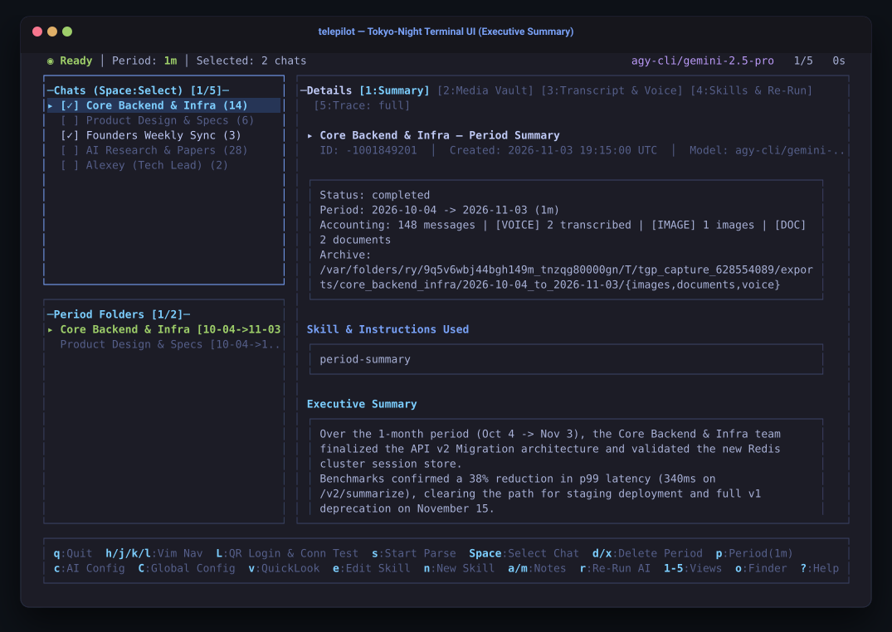
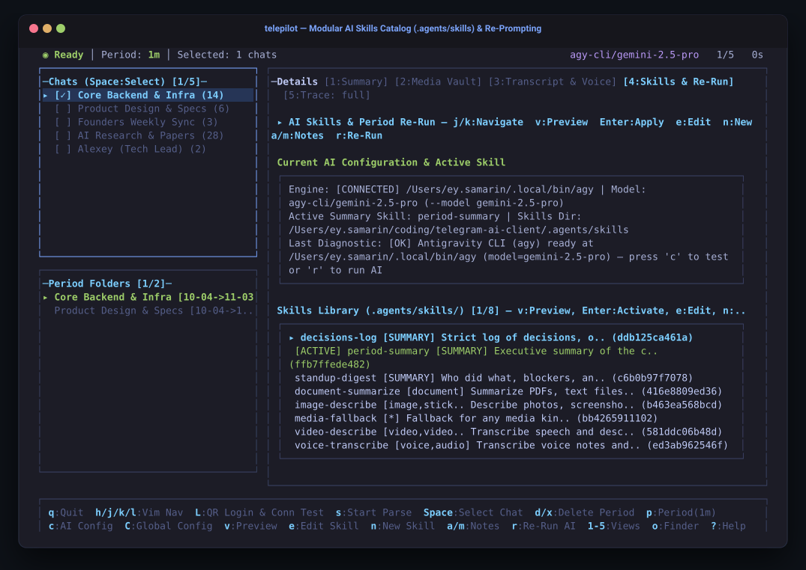
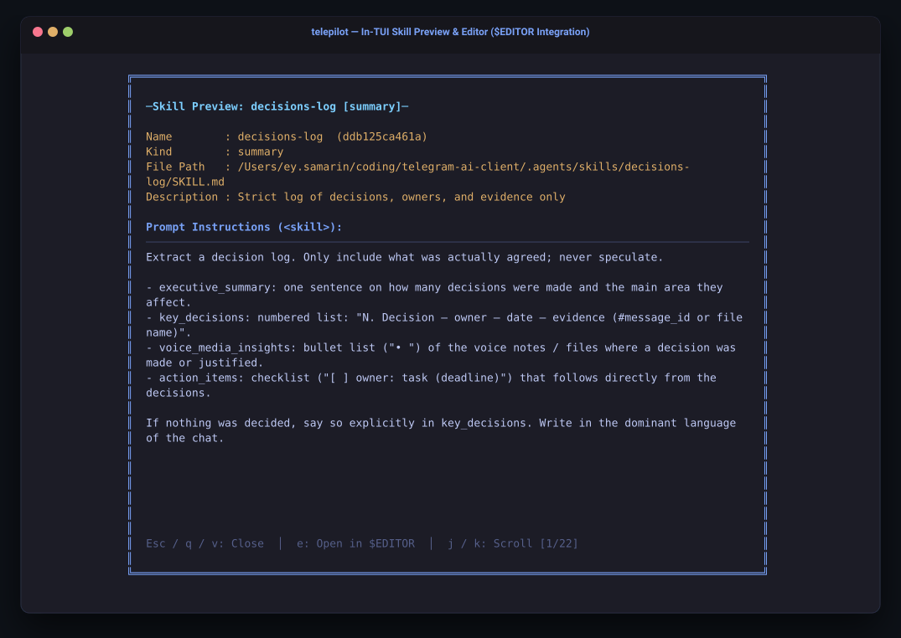
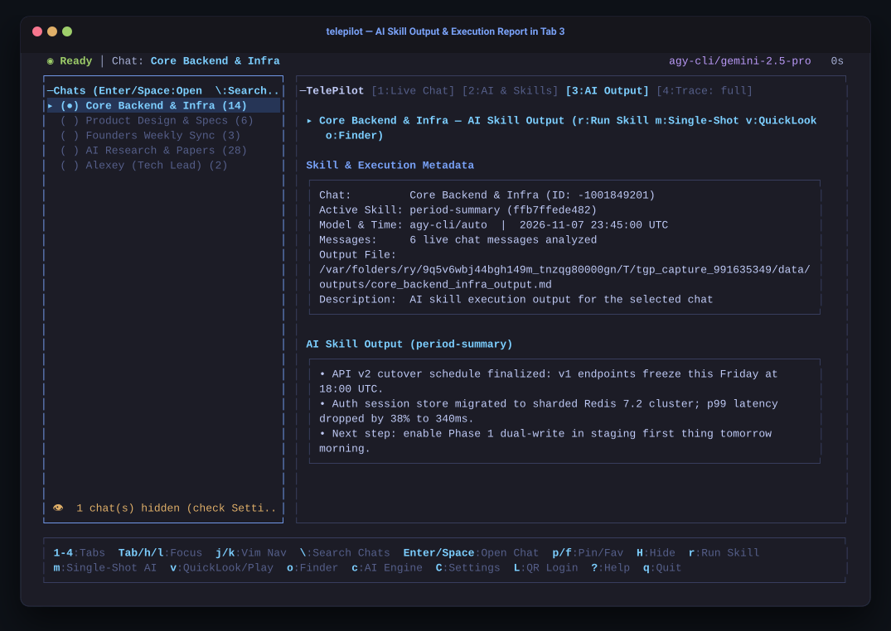
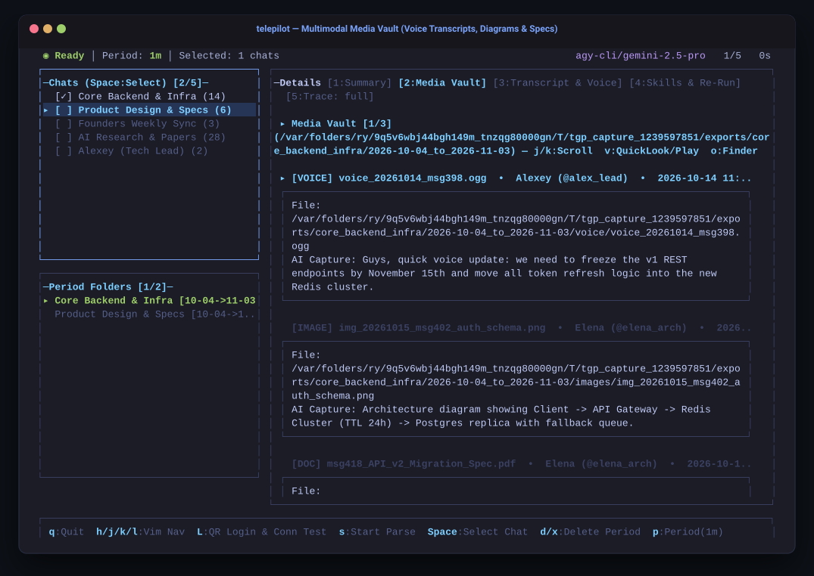
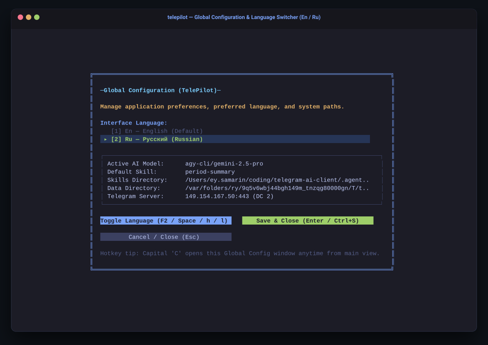
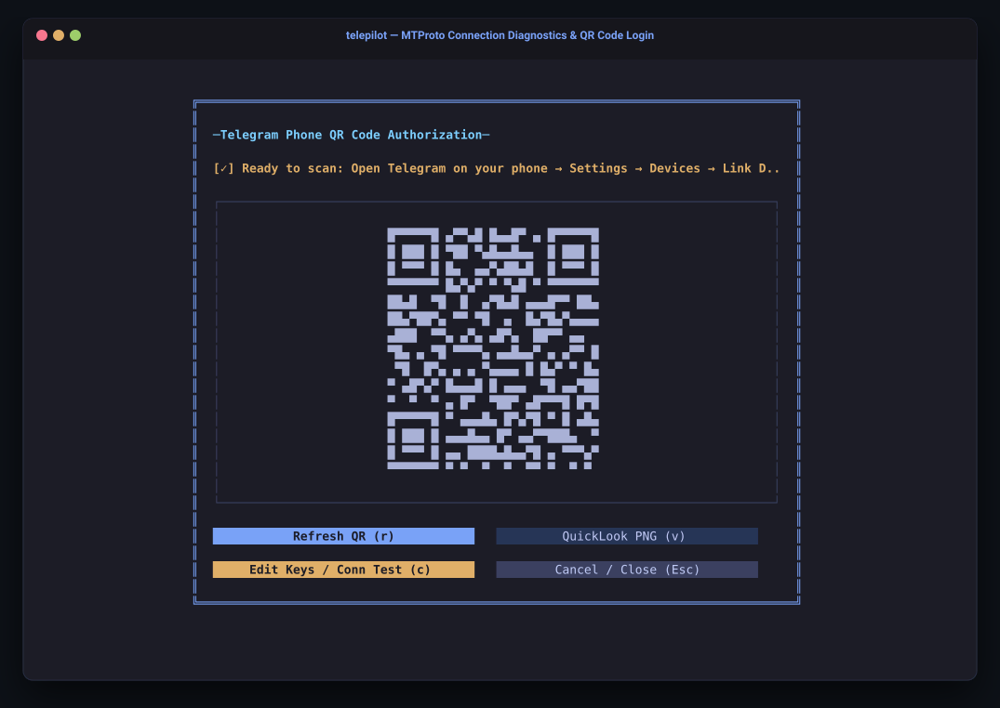

# TelePilot (`tgp`)

<p align="center">
  
  
  
  
  
</p>

<p align="center">
  A lightweight, keyboard-driven <strong>Telegram AI Client & Skill Runner</strong> for macOS built with <strong>pure Go (<a href="https://github.com/gotd/td">gotd/td</a> MTProto)</strong>, <strong><a href="https://github.com/charmbracelet/bubbletea">Charm Bubble Tea</a> & <a href="https://github.com/charmbracelet/lipgloss">Lipgloss</a></strong>, and <strong>Antigravity CLI (<code>agy</code>) / Google Gemini Multimodal AI</strong>.
</p>

<p align="center">
  Works <strong>alongside your official Telegram macOS app</strong> (using Telegram's native multi-session capability) to give you a dedicated <strong>Tokyo-Night Terminal UI</strong> with real-time two-way messaging, per-chat AI auto-reply & single-shot instructions, multimodal voice/media analysis, and flexible AI skill execution.
</p>

---

<p align="center">
  <a href="#-key-features">
    
  </a>
</p>

---

## ⚡ Key Features

### 1. Real-Time Live Chat & AI Message Control (`[1:Live Chat]`)
- **Human-Readable Chat Stream**: Clean chronological message timeline with date dividers (`─── YYYY-MM-DD ───`), grouped consecutive senders, aligned `HH:MM │` columns, and inline voice note transcripts (`🎙️`).
- **Single-Chat Focus & `[AI]` Badge**: Select any dialog in the Chats sidebar with `Enter` or `Space`. Chats with AI enabled are highlighted in purple with an **`[AI]`** badge.
- **Two-Way Messaging & Real-Time Sync**: Press **`i`** or **`Enter`** in Tab 1 to compose and send messages directly over MTProto, backed by live push updates and automatic background sync.
- **Native Media QuickLook (`v`) & Finder (`o`)**:
  - Press **`v`** to QuickLook media files (photos, documents) or play voice notes via `afplay`.
  - Press **`o`** to reveal cached media files directly in macOS Finder via `open -R`.
- **AI Reply & Single-Shot Control**:
  - Press **`a`** in Tab 1 (or **`A`** in Tab 2) to generate an on-demand AI reply to the latest conversation context.
  - Press **`m`** in Tab 1 or Tab 2 to launch a standalone **Single-Shot AI Instruction** for the active chat.

---

### 2. Per-Chat AI Instructions, Single-Shot Runner & Skills (`[2:AI & Skills]`)
Configure AI behavior independently for each Telegram chat (persisted in `data/chat_ai_config.json`):
- **Two-Level Box Navigation**:
  - **Level 1 (Box Selection)**: Use **`j` / `k`** to move between the 5 cards (`AI Actions & Shortcuts`, `Per-Chat AI Instructions`, `Common AI Engine Configuration`, `Skills Library`, and `Selected Chat Latest AI Skill Output`) without losing cursor focus.
  - **Level 2 (Inside a Box)**: Press **`Enter`** to drill into the highlighted box (border turns green `◆`) to toggle per-chat AI settings or browse and assign skills; press **`Esc`** (or `Backspace`) to step back out to box selection.
- **Per-Chat AI Message Control**:
  - **Colorized Status Badges**: Instant visual clarity with green **`[ON]` / `[ACTIVE]` / `[CONNECTED]`** and red **`[OFF]` / `[NOT CONFIGURED]`** badges across structured indented option lists.
  - **Auto-Reply (`a`)**: Automatically respond to new incoming messages in the selected chat using AI.
  - **Send Mode (`s`)**: Toggle between **`Draft to Compose Box (Enter to confirm)`** (safe review before sending) and **`Auto-Send Immediately`** (hands-free autonomous replies).
- **Standalone Single-Shot AI Instructions (`m`)**:
  - Give the AI ad-hoc instructions for the current chat (e.g., *"send 3 different messages starting with AI prefix every 15 seconds"* or *"reply politely that I'm in a meeting"*), completely separate from skill execution.
  - **`Enter`** cancels any previously running instruction for that chat and starts the new single-shot immediately; **`Ctrl+A`** appends/queues onto the currently running instruction; **`Ctrl+X`** stops and clears the active runner.
- **Modular Skills Library (`.agents/skills/`)**:
  - Pre-installed skills (`period-summary`, `decisions-log`, `standup-digest`, `voice-transcribe`, `document-summarize`, `image-describe`, `video-describe`).
  - **macOS Finder & Editor Integration**:
    - Press **`v`** to preview a skill's `SKILL.md` in-TUI.
    - Press **`e`** to edit `SKILL.md` in terminal `$EDITOR` (e.g. `nano`, `vim`).
    - Press **`O`** to open the skill in your macOS default GUI editor.
    - Press **`o`** to reveal the skill or `.agents/skills/` folder directly in macOS Finder.
    - Press **`I`** to open the native macOS Finder file picker to import external skill files or folders.
    - Press **`n`** to scaffold a new skill or paste/drag an existing path.
    - **Live Auto-Reload**: Any skills added, edited, or deleted in Finder or an external editor are detected and reloaded automatically in real time.

<p align="center">
  
</p>

<p align="center">
  
</p>

---

### 3. AI Skill Output & Execution Reports (`[3:AI Output]`)
Run any skill on the selected chat's messages and view its natural output in Tab 3:
- **Free-Form AI Output**: Unconstrained, natural output formatted by your active skill (e.g. `standup-digest`, `decisions-log`, `document-summarize`, `period-summary`, or any custom skill in `.agents/skills/`) without forcing rigid schemas.
- **Skill & Execution Metadata**: Clear breakdown of the active skill, skill hash, model used, timestamp, message count, and output file path (`data/outputs/<chat>_output.md`).
- **One-Key Skill Execution (`r`)**: Press **`r`** anywhere in Tab 2 or Tab 3 to run the active skill directly on the selected chat. Upon completion, TelePilot switches directly to Tab 3 to display the result.
- **Native macOS QuickLook (`v`) & Finder (`o`)**:
  - Press **`v`** to view the generated Markdown report in your default macOS viewer.
  - Press **`o`** to reveal the output Markdown file in macOS Finder via `open -R`.
- **Persistent Storage**: Latest skill results are saved per-chat in `data/chat_skill_outputs.json` and persisted as Markdown files in `data/outputs/`.

<p align="center">
  
</p>

<p align="center">
  
</p>

---

### 4. Global Configuration, Bilingual Language Switcher, Favourite & Hidden Chats (`C`)
TelePilot features first-class internationalization with instant switching between English and Russian, along with dedicated Favourite / Pinned and Hidden Chats management:
- Press **`C`** (capital C) anytime to open the **Global Configuration** modal with intuitive 2-level box navigation (`Enter` to enter a block, `Esc` to return).
- Toggle between **English (`En`)** and **Russian (`Ru — Русский`)** using `Space` or `1`/`2` keys.
- Inspect and manage **Favourite / Pinned Chats**: easily delete chats from your favourites list (especially corner cases where a chat was deleted from another Telegram client and is no longer present in active dialogs).
- Inspect and manage **Hidden Chats**: hide noisy or private chats directly from the sidebar with **`H`** (or `x`), excluding them from the visible list. When chats are hidden, an indicator item (`👁 X chat(s) hidden`) appears under the chats sidebar. Quickly restore any chat at any time in Block 2 of the Settings modal (`d`/`x`/`u`).
- Live localization across all top status bars, sidebars, tabs, cards, modals, and keyboard hints.

<p align="center">
  
</p>

---

### 5. Instant Phone QR Pairing & MTProto Diagnostics (`L` or `--qr`)
Sign in with your phone camera in seconds:
- Press **`L`** anytime in the TUI (or launch with `telepilot --qr`).
- Live rendered Unicode QR code block right in your terminal with automatic MTProto DC ping and connection diagnostics.
- Works alongside your existing Telegram macOS desktop app without terminating existing sessions.

<p align="center">
  
</p>

---

## 📁 Data & Skills Architecture

TelePilot stores per-chat configurations and AI skill outputs cleanly in `data/` and modular skills in `.agents/skills/`:

```text
data/
├── chat_ai_config.json      # Per-chat AI status, active skill, auto-reply, send mode & single-shot state
├── chat_skill_outputs.json  # Cached AI skill outputs & execution metadata per chat
├── favorite_chats.json      # Persisted favourite / pinned chats list
├── hidden_chats.json        # Persisted hidden chats list
└── outputs/                 # Exported Markdown output files (<chat_slug>_output.md) for QuickLook (v) & Finder (o)

.agents/skills/              # Modular AI skills (SKILL.md) loaded dynamically with live reload
├── decisions-log/
├── document-summarize/
├── image-describe/
├── period-summary/
├── standup-digest/
├── video-describe/
└── voice-transcribe/
```

---

## 🚀 Quick Start

### 1. Install `telepilot` (and alias `tgp`)
Run the installer script once to compile and place `telepilot` and `tgp` into `~/.local/bin`:

```bash
./install.sh
source ~/.zshrc
```

*(You can also pass a custom alias name: `./install.sh telegent`)*

### 2. Launch the TUI
```bash
telepilot
# or using the 3-letter shortcut:
tgp
```

### 3. Pair with Your Phone
Launch directly into the QR code pairing modal:
```bash
telepilot --qr
```
1. Paste your `TELEGRAM_API_ID` & `TELEGRAM_API_HASH` (from [my.telegram.org/apps](https://my.telegram.org/apps)) and configure your AI engine (`agy` CLI or `GEMINI_API_KEY`).
2. On your phone, open **Telegram → Settings → Devices → Link Desktop Device** and scan the QR code rendered in your terminal.

---

## ⌨️ Keyboard Shortcuts Reference

| Key | Context | Action |
| :--- | :--- | :--- |
| **`1` – `4`** | Global | Switch main tab (`1:Live Chat`, `2:AI & Skills`, `3:AI Output`, `4:Trace`) |
| **`Tab` / `h` / `l`** | Global | Switch focus between Chats sidebar and Main panel |
| **`j` / `k`**, **`g` / `G`** | Global | Vim-style vertical navigation (single line, top, bottom) |
| **`\` / `/`** | Chats Sidebar | Vim-style search through chats by title or username (`Enter`: Open, `Esc`: Clear) |
| **`Enter` / `Space`** | Sidebar | Open and select the highlighted chat `(●)` |
| **`p` / `f`** | Chats Sidebar / Global | Pin or unpin favourite chat on top of the chats list (`📌`) |
| **`H` / `x`** | Chats Sidebar | Hide chat from list (excluded from view; managed in Settings `C`) |
| **`i` / `Enter`** | Tab 1 (`Live Chat`) | Focus the compose box to write and send a message (`Esc` to cancel) |
| **`a`** | Tab 1 (`Live Chat`) | Generate an on-demand AI reply for the active chat |
| **`m`** | Tab 1, 2, 3 | Open **Single-Shot AI Instruction** modal (`Enter`: Replace & Run, `Ctrl+A`: Append, `Ctrl+X`: Stop) |
| **`Enter` / `Esc`** | Tab 2 (`AI & Skills`) | Drill into selected box (`Enter`) / Exit back to box-level navigation (`Esc`) |
| **`a`** | Tab 2 (`AI & Skills`) | Toggle per-chat **AI Auto-Reply** (`[ON]` / `[OFF]`) |
| **`s`** | Tab 2 (`AI & Skills`) | Toggle per-chat **AI Send Mode** (`Draft to Compose Box` vs `Auto-Send Immediately`) |
| **`A`** | Tab 2 (`AI & Skills`) | Trigger an immediate on-demand **AI Reply** for the selected chat |
| **`x`** | Tab 2 (`AI & Skills`) | Disable AI instructions for the selected chat |
| **`v` / `e`** | Tab 2 (`Skills Library`) | Preview skill in-TUI (`v`) or edit `SKILL.md` in `$EDITOR` (`e`) |
| **`O` / `o`** | Tab 2 (`Skills Library`) | Open skill in macOS GUI editor (`O`) or reveal skill in macOS Finder (`o`) |
| **`n` / `I`** | Tab 2 (`Skills Library`) | Create new skill / paste path (`n`) or import skill via native macOS Finder picker (`I`) |
| **`r`** | Tab 1, 2, 3 | Refresh live chat (Tab 1) or run active AI skill on selected chat (Tab 2 & Tab 3) |
| **`v` / `o`** | Tab 1, 2, 3 | Play voice / QuickLook media or reveal in Finder (`o`) (Tab 1), preview / Finder (Tab 2), QuickLook / Finder (`o`) (Tab 3) |
| **`c`** | Global | Open **AI Engine Configuration** modal (Antigravity CLI `agy` or Gemini API) |
| **`C`** | Global | Open **Global Configuration** modal (language switch & favourite/pinned chats management) |
| **`L`** | Global | Open **MTProto Connection Diagnostics & QR Code Login** modal |
| **`?` / `q`** | Global | Show Help modal (`?`) / Quit (`q`) |

---

## 📄 License

MIT © [Evgeny Samarin](https://github.com/EvgenySamarin)
