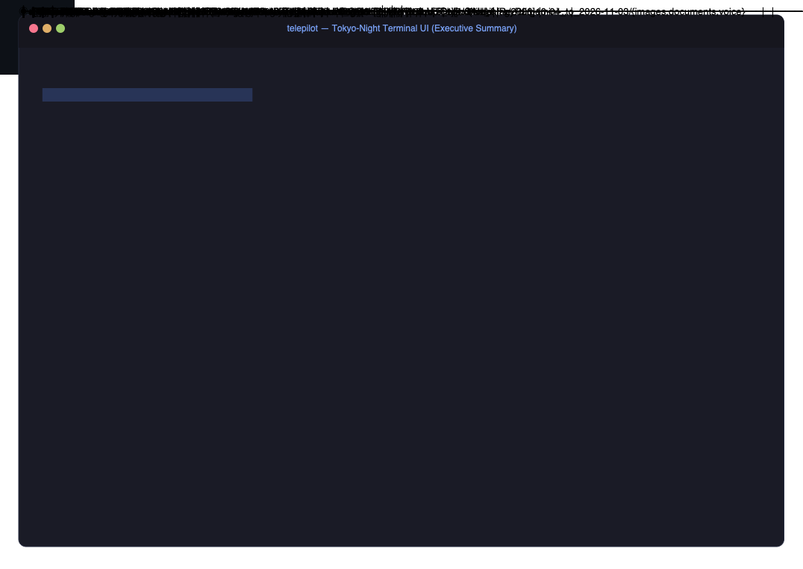
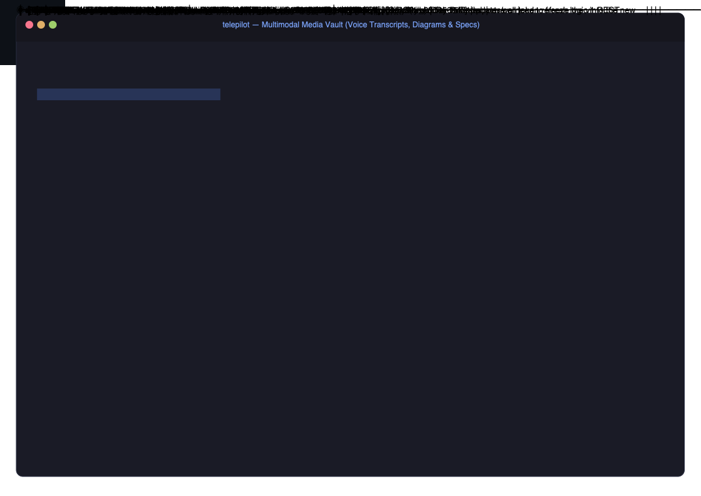
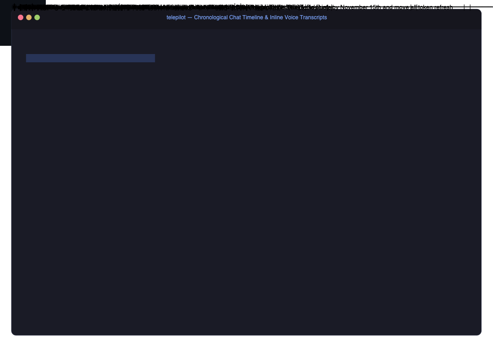
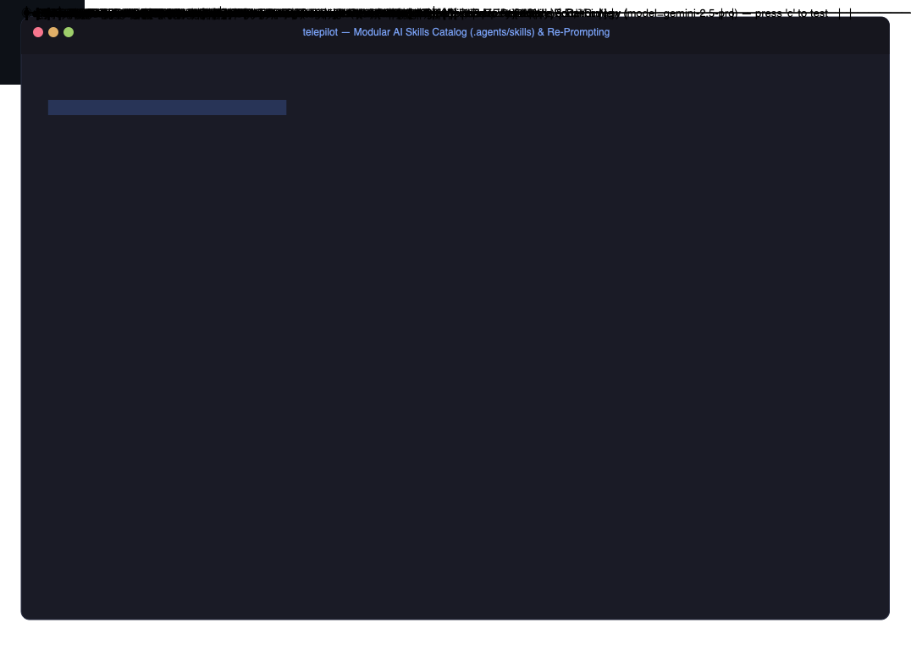
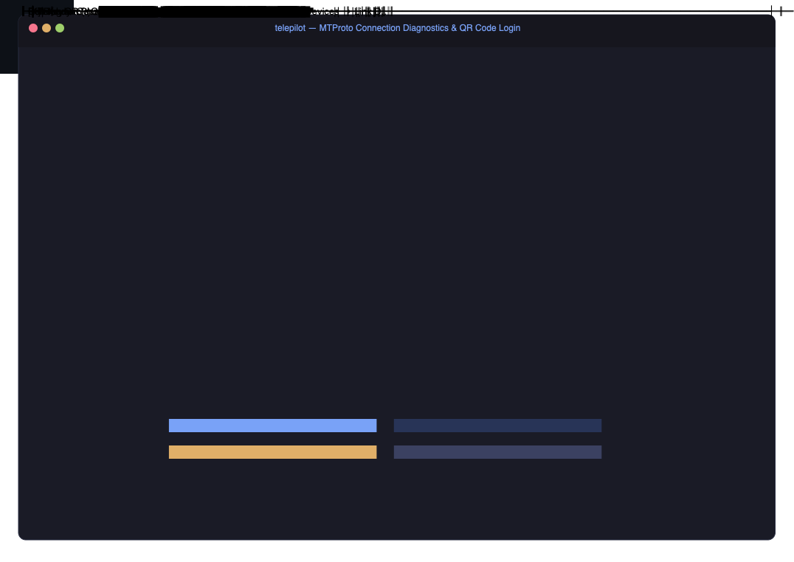

# TelePilot (`tgp`)

<p align="center">
  
  
  
  
  
</p>

<p align="center">
  A lightweight, keyboard-driven <strong>Telegram AI Summarizer Client</strong> for macOS built with <strong>pure Go (<a href="https://github.com/gotd/td">gotd/td</a> MTProto)</strong>, <strong><a href="https://github.com/charmbracelet/bubbletea">Charm Bubble Tea</a> & <a href="https://github.com/charmbracelet/lipgloss">Lipgloss</a></strong>, and <strong>Google Gemini Multimodal AI</strong>.
</p>

<p align="center">
  Works <strong>alongside your official Telegram macOS app</strong> (using Telegram's native multi-session capability) so you get a dedicated <strong>Tokyo-Night Terminal UI</strong> with multimodal voice transcription, document parsing, and period summarization.
</p>

---

<p align="center">
  <a href="#key-features">
    
  </a>
</p>

---

## ⚡ Key Features

### 1. Tokyo-Night Terminal Dashboard (`[1:Summary]`)
- **Top Status Bar**: Live pipeline indicators (`◉ Ready`, `⟳ Transcribing voice...`), active AI model (`gemini-2.5-pro`), batch progress (`1/5`), and elapsed time timer (`⏱ 14s`).
- **Multi-Select Chats Sidebar**: Select and toggle multiple chats/groups/channels using `Space` and batch-parse them with `s`.
- **Period Summary Folders**: Directly browse historical `exports/<chat>/<YYYY-MM-DD_to_YYYY-MM-DD>/` archives on disk.
- **Card-Based Summaries**: Interior structured cards for **Metadata**, **Active Skill**, **Executive Summary**, **Key Decisions & Highlights**, **Voice/Media Accounting**, and **Action Items Checklist**.

---

### 2. Multimodal Media Vault (`[2:Media Vault]`)
Inspect every file downloaded during a chat period—voice recordings, whiteboard photos, diagrams, and PDF specs—with automated AI transcription and vision analysis:
- **macOS QuickLook (`v`)**: Instantly preview images, PDFs, and play `.ogg` voice notes via native macOS `qlmanage -p` or `afplay`.
- **Finder Reveal (`o`)**: One keypress opens the period's folder in macOS Finder.

<p align="center">
  
</p>

---

### 3. Chronological Transcript & Inline Voice Notes (`[3:Transcript & Voice]`)
Full chronological timeline of conversation messages with inline speech recognition:
- Voice messages expand inline into text callouts (`🎙️ Voice Transcript`).
- Media items, senders, deep links (`https://t.me/c/...`), and reply references are highlighted.

<p align="center">
  
</p>

---

### 4. Modular AI Skills & Re-Prompting (`[4:Skills & Re-Run]`)
Extensible skill system stored in `.agents/skills/`:
- **Pre-installed Skills**:
  - `period-summary`: Comprehensive executive report with action items and decisions.
  - `decisions-log`: Strict log of key architectural agreements, owners, and evidence.
  - `standup-digest`: Team sync digest categorized by person (completed work, blockers, next steps).
  - `voice-transcribe`: High-fidelity audio speech-to-text transcription.
  - `document-summarize`: PDF, CSV, and specification document distillation.
  - `image-describe` & `video-describe`: Multimodal computer vision analysis.
- **Custom Prompts & Hotkeys**: Press `a` or `m` to attach custom instructions, `e` to edit any skill in `$EDITOR`, `n` to create a new skill, and `r` to re-run AI inference without re-downloading media.

<p align="center">
  
</p>

---

### 5. Instant Phone QR Pairing & MTProto Diagnostics (`L` or `--qr`)
No complicated auth flows—sign in in seconds with your phone camera:
- Press **`L`** anytime in the TUI (or launch with `telepilot --qr`).
- Live rendered Unicode QR code block right in your terminal.
- Automatic MTProto DC 2 ping and connection diagnostics.
- Works alongside your existing Telegram macOS desktop app without terminating existing sessions.

<p align="center">
  
</p>

---

## 📁 Period-Based Export Architecture

When you summarize a chat, TelePilot downloads and organizes all assets cleanly into a self-contained folder:

```text
exports/<chat_slug>/<YYYY-MM-DD>_to_<YYYY-MM-DD>/
├── images/        # Downloaded photos, diagrams & whiteboard screenshots
├── documents/     # Downloaded PDFs, CSV benchmarks, technical specs
├── voice/         # Downloaded .ogg voice messages + .txt transcripts
├── transcript.md  # Chronological timeline with inline voice transcriptions
├── summary.md     # Markdown executive report
└── metadata.json  # Structured JSON cache for instant re-prompting
```

---

## 🚀 Quick Start

### 1. Install `telepilot` (and alias `tgp`)
Run the installer script once to compile and place `telepilot` and `tgp` into `~/.local/bin`:

```bash
./install.sh
source ~/.zshrc
```

*(You can also pass a custom alias name: `./install.sh telegent`)*

### 2. Launch the TUI
```bash
telepilot
# or using the 3-letter shortcut:
tgp
```

### 3. Pair with Your Phone
Launch directly into the QR code pairing modal:
```bash
telepilot --qr
```
1. Paste your `TELEGRAM_API_ID` & `TELEGRAM_API_HASH` (from [my.telegram.org/apps](https://my.telegram.org/apps)) and `GEMINI_API_KEY` (from [aistudio.google.com/apikey](https://aistudio.google.com/apikey)).
2. On your phone, open **Telegram → Settings → Devices → Link Desktop Device** and scan the QR code rendered in your terminal.

---

## ⌨️ Keyboard Shortcuts Reference

| Key | Action |
| :--- | :--- |
| **`Space`** | Toggle `[✓]` multi-selection on chats in the sidebar |
| **`a`** | Select / Deselect all chats (or edit run notes when in Skills tab) |
| **`s` / `Enter`** | Start parsing & summarizing selected chats (or activate skill in Tab 4) |
| **`p`** | Change parsing period (e.g. `7d`, `2w`, `1m`, `3m`, or `YYYY-MM-DD..YYYY-MM-DD`) |
| **`1` – `5`** | Switch main view (`Summary`, `Media Vault`, `Transcript`, `Skills`, `Trace`) |
| **`r`** | Re-run AI analysis on active period folder using selected skill |
| **`e`** | Open selected skill's `SKILL.md` in `$EDITOR` (`vim`, `nano`, `code`) |
| **`n`** | Create a new custom skill in `.agents/skills/` from template |
| **`v`** | QuickLook preview for images/PDFs/QR codes or playback voice notes (`afplay`) |
| **`o`** | Open active period folder in **macOS Finder** |
| **`d` / `x`** | Delete selected period folder |
| **`L`** | Open **MTProto Connection Diagnostic & QR Code Login** modal |
| **`c`** | Open **AI Engine Configuration** modal (switch models with `F2`) |
| **`C`** | Open **Global Configuration** modal (switch language between En and Ru) |
| **`?`** | Show Help modal |
| **`q`** | Quit |

---

## 🛠️ Regenerating Assets & Screenshots

TelePilot includes a built-in terminal capture utility that renders the Lipgloss Bubble Tea screens directly into vector SVGs and pixel-perfect PNGs:

```bash
go run cmd/screens/main.go
```

Outputs are written to `assets/` with Tokyo-Night styling, macOS window chrome, and drop shadows.

---

## 📄 License

MIT © [Evgeny Samarin](https://github.com/EvgenySamarin)
